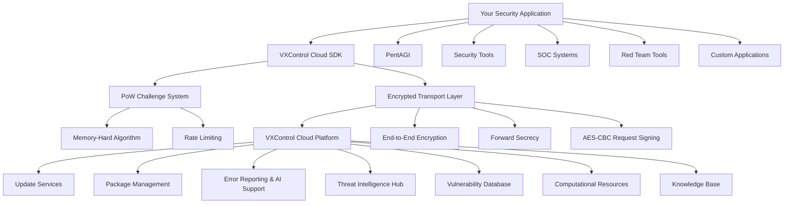

# VXControl Cloud SDK

<div align="center" style="font-size: 1.5em; margin: 20px 0;">
    Enterprise-grade Go SDK for secure integration with VXControl Cloud Intelligence Platform and Services.
</div>
<br>
<div align="center">

> 🚀 **Join the Community!** Connect with security researchers, AI enthusiasts, and fellow ethical hackers. Get support, share insights, and stay updated with the latest PentAGI developments.

[](https://discord.gg/2xrMh7qX6m)⠀[](https://t.me/+Ka9i6CNwe71hMWQy)

</div>

## Overview

The VXControl Cloud SDK enables developers to integrate their security tools and applications with the VXControl Cloud Intelligence Platform, providing access to advanced cybersecurity services including threat intelligence, vulnerability databases, computational resources, AI-powered troubleshooting, and automated update systems.

## Key Features

- **Type-Safe API**: 24 strongly-typed function patterns covering all request/response scenarios
- **Transparent Security**: Automatic proof-of-work solving and end-to-end encryption
- **Performance Optimized**: HTTP/2 support, connection pooling, streaming encryption
- **Enterprise Ready**: Comprehensive error handling, retry logic, and production monitoring
- **License Integration**: Built-in premium feature validation and tier management
- **Endpoint Health Probing**: `Check()` API for pre-flight connectivity and quota verification
- **Structured Rate Limit Errors**: `RateLimitError` / `QuotaError` carry server-advertised `Retry-After` cooldowns
- **Context-Safe Retries**: Cancelled context during back-off preserves the last `*RateLimitError` so callers can still read `RetryAfter`

## Quick Start

### Installation

```bash
go get github.com/vxcontrol/cloud/sdk
```

### Basic Usage

```go
package main

import (
    "context"
    "encoding/json"
    "log"

    "github.com/vxcontrol/cloud/models"
    "github.com/vxcontrol/cloud/sdk"
    "github.com/vxcontrol/cloud/system"

    "github.com/sirupsen/logrus"
)

type Client struct {
    UpdatesCheck  sdk.CallReqBytesRespBytes
    ReportError   sdk.CallReqBytesRespBytes
}

func main() {
    var client Client

    // Configure endpoints
    configs := []sdk.CallConfig{
        {
            Calls:  []any{&client.UpdatesCheck},
            Host:   "update.pentagi.com",
            Name:   "updates_check",
            Path:   "/api/v1/proxy/updates/check",
            Method: sdk.CallMethodPOST,
        },
        {
            Calls:  []any{&client.ReportError},
            Host:   "support.pentagi.com",
            Name:   "errors_report",
            Path:   "/api/v1/proxy/errors/report",
            Method: sdk.CallMethodPOST,
        },
    }

    // Initialize SDK
    err := sdk.Build(configs,
        sdk.WithClient("MySecTool", "1.0.0"),
        sdk.WithInstallationID(system.GetInstallationID()),
        sdk.WithLogger(sdk.WrapLogrus(logrus.StandardLogger())),
        sdk.WithLicenseKey("XXXX-XXXX-XXXX-XXXX"),
    )
    if err != nil {
        log.Fatal("SDK initialization failed:", err)
    }

    // Check for updates. Strategy is required — it tells the server whether to
    // resolve components against a curated release ("stable"), a release plus
    // channel metadata ("preview"), or the raw channel alone ("nightly").
    updateReq := models.CheckUpdatesRequest{
        InstallerVersion: "1.0.0",
        InstallerOS:      models.OSTypeLinux,
        InstallerArch:    models.ArchTypeAMD64,
        Strategy:         models.UpdateStrategyStable,
    }

    data, _ := json.Marshal(updateReq)
    response, err := client.UpdatesCheck(context.Background(), data)
    if err != nil {
        log.Fatal("Update check failed:", err)
    }

    // Every response body arrives wrapped in {"status":…,"data":…}. Decoding it
    // straight into CheckUpdatesResponse "succeeds" and silently yields an empty
    // update list — always unwrap it with ParseEnvelope instead.
    updateResp, err := models.ParseEnvelope[models.CheckUpdatesResponse](response)
    if err != nil {
        log.Fatal("Update check failed:", err)
    }
    log.Printf("Available updates: %+v", updateResp.Updates)
}
```

## Architecture



## Cloud Services Integration

### Update Management
Keep PentAGI with automated update checking:

```go
import "github.com/vxcontrol/cloud/models"

// Check for component updates. Installed artefacts are reported separately by
// how they are delivered: pulled container images vs. downloaded files.
// Report every product stack you know about too, including unused ones — a
// stack hosted externally and a stack nobody uses look identical otherwise.
updateReq := models.CheckUpdatesRequest{
    InstallerVersion: "1.0.0",
    InstallerOS:      models.OSTypeLinux,
    InstallerArch:    models.ArchTypeAMD64,
    Strategy:         models.UpdateStrategyStable,
    Images: []models.ImageComponentInfo{
        {
            Component:  models.ComponentTypePentagi,
            Status:     models.ComponentStatusRunning,
            OS:         models.OSTypeLinux, // the ARTEFACT's platform, not the host's
            Arch:       models.ArchTypeAMD64,
            Repository: "vxcontrol/pentagi",
            Tag:        "latest",
        },
    },
    Stacks: []models.StackInfo{
        {Stack: models.ProductStackPentagi, Status: models.StackStatusInstalled},
    },
}

data, _ := json.Marshal(updateReq)
response, err := client.UpdatesCheck(ctx, data)

updateResp, err := models.ParseEnvelope[models.CheckUpdatesResponse](response)
```

### Error Reporting & AI Support
Get intelligent assistance for troubleshooting:

```go
// Report an error for analysis
errorReq := models.SupportErrorRequest{
    Component:    models.ComponentTypePentagi,
    Version:      "1.0.0",
    OS:          models.OSTypeLinux,
    Arch:        models.ArchTypeAMD64,
    ErrorDetails: map[string]any{
        "error_type": "connection_timeout",
        "message":    "Failed to connect to target",
        "context":    map[string]string{"target": "192.168.1.1", "port": "443"},
    },
}

data, _ := json.Marshal(errorReq)
response, err := client.ReportError(ctx, data)
```

### Package Management
Download and validate software packages:

```go
// Get package information
packageReq := models.PackageInfoRequest{
    Component: models.ComponentTypePentagi,
    Version:   "1.0.0",
    OS:        models.OSTypeLinux,
    Arch:      models.ArchTypeAMD64,
}

// Validate package integrity with signatures
signature := models.SignatureValue("base64-encoded-signature")
fileData, _ := os.ReadFile("package.tar.gz")
if err := signature.ValidateData(fileData); err != nil {
    log.Fatal("Package signature validation failed:", err)
}
```

### AI-Powered Troubleshooting
Interactive support with investigation capabilities:

```go
// Create support issue
issueReq := models.SupportIssueRequest{
    Component:    models.ComponentTypeEngine,
    Version:      "2.0.0",
    OS:          models.OSTypeDarwin,
    Arch:        models.ArchTypeARM64,
    ErrorDetails: "Scanner fails to detect specific vulnerability patterns",
    Logs: []models.SupportLogs{
        {
            Component: models.ComponentTypeEngine,
            Logs:      []string{"ERROR: Pattern matching timeout", "WARN: Memory usage high"},
        },
    },
}

// Investigate with AI assistance. IssueID is the value returned by the
// SupportIssueResponse above — it is how a client keeps a multi-turn
// conversation about the same issue across separate calls.
investigationReq := models.SupportInvestigationRequest{
    IssueID:   receivedIssueID,
    UserInput: "The scanner works fine with other patterns but fails on this specific CVE",
}

// Bind IssueInvestigate to CallReqBytesRespBytes for the default JSON answer:
data, _ := json.Marshal(investigationReq)
response, err := client.IssueInvestigate(ctx, data)
answer, err := models.ParseEnvelope[models.SupportInvestigationResponse](response)
// answer.Answer is the reply text; answer.MsgLogs carries the full anonymised
// conversation transcript when the server attaches one.

// Or set UseStream and bind IssueInvestigate to CallReqBytesRespReader instead,
// to receive the same answer incrementally as Server-Sent Events — the stream
// is NOT wrapped in the {"status":…,"data":…} envelope, unlike every other response.
investigationReq.UseStream = true
```

## Call Function Types

The SDK generates 24 strongly-typed function patterns, one for every combination of request shape (none / query / path args / query+args), request body (none / bytes / reader), and response shape (bytes / reader / writer). Assign the field a value of one of these types and `sdk.Build` fills it in for the `CallConfig` it matches:

| Pattern | Request | Body | Response | Use Case |
|---------|---------|------|----------|----------|
| `CallReqRespBytes` | None | None | Bytes | Simple JSON/binary retrieval |
| `CallReqRespReader` | None | None | Reader | Large downloads as a stream |
| `CallReqRespWriter` | None | None | Writer | Stream a response into an `io.Writer` |
| `CallReqQueryRespBytes` | Query | None | Bytes | Filtered queries (`?limit=10&offset=20`) |
| `CallReqQueryRespReader` | Query | None | Reader | Query-based downloads |
| `CallReqQueryRespWriter` | Query | None | Writer | Query-based streaming (used by `download-installer`) |
| `CallReqWithArgsRespBytes` | Path args | None | Bytes | RESTful resource access (`/users/:id`) |
| `CallReqWithArgsRespReader` | Path args | None | Reader | Resource-specific downloads |
| `CallReqWithArgsRespWriter` | Path args | None | Writer | Resource-specific streaming |
| `CallReqQueryWithArgsRespBytes` | Path args + Query | None | Bytes | Combined path + query lookups |
| `CallReqQueryWithArgsRespReader` | Path args + Query | None | Reader | Combined lookups, streamed response |
| `CallReqQueryWithArgsRespWriter` | Path args + Query | None | Writer | Combined lookups streamed to a writer |
| `CallReqBytesRespBytes` | None | Bytes | Bytes | JSON API calls (used by `check-update`, `report-errors`) |
| `CallReqBytesRespReader` | None | Bytes | Reader | JSON request, SSE/streamed response (AI investigation) |
| `CallReqBytesRespWriter` | None | Bytes | Writer | JSON request, response streamed to a writer |
| `CallReqReaderRespBytes` | None | Reader | Bytes | Streamed upload, JSON response |
| `CallReqReaderRespReader` | None | Reader | Reader | Stream-to-stream processing |
| `CallReqReaderRespWriter` | None | Reader | Writer | Streamed upload with streamed output |
| `CallReqBytesWithArgsRespBytes` | Path args | Bytes | Bytes | Resource updates with a JSON body |
| `CallReqBytesWithArgsRespReader` | Path args | Bytes | Reader | Resource updates with a streamed response |
| `CallReqBytesWithArgsRespWriter` | Path args | Bytes | Writer | Resource updates streamed to a writer |
| `CallReqReaderWithArgsRespBytes` | Path args | Reader | Bytes | Streamed uploads to a specific resource |
| `CallReqReaderWithArgsRespReader` | Path args | Reader | Reader | Resource-targeted stream processing |
| `CallReqReaderWithArgsRespWriter` | Path args | Reader | Writer | Resource-targeted streamed upload/download |

> **Note:** only calls with a `[]byte` body (`*Bytes*` variants) are retried automatically on a temporary failure — see [Automatic Retry Logic](#automatic-retry-logic). A call built with a raw `io.Reader` body cannot be rewound after a failed attempt, so the SDK disables retries for it.

[Complete function reference](https://pkg.go.dev/github.com/vxcontrol/cloud/sdk)

## Configuration Options

### Basic Configuration

```go
err := sdk.Build(configs,
    // Required: Client identification
    sdk.WithClient("MyApp", "1.0.0"),

    // Optional: Premium features
    sdk.WithLicenseKey("XXXX-XXXX-XXXX-XXXX"),

    // Optional: Performance tuning
    sdk.WithPowTimeout(30*time.Second),
    sdk.WithMaxRetries(3),
)
```

### Advanced Configuration

```go
// Custom transport for proxies/certificates
transport := sdk.DefaultTransport()
transport.TLSClientConfig = &tls.Config{
    MinVersion: tls.VersionTLS12,
    // custom certificate validation
}
transport.Proxy = http.ProxyURL(proxyURL)

// Custom structured logging
logger := logrus.New()
logger.SetLevel(logrus.InfoLevel)

err := sdk.Build(configs,
    sdk.WithTransport(transport),
    sdk.WithLogger(sdk.WrapLogrus(logger)),
    sdk.WithInstallationID(system.GetInstallationID()),
)
```

## Security Model

### Proof-of-Work Protection
All API calls require solving computational challenges to prevent abuse and DDoS attacks. The SDK automatically:
- Requests challenge tickets from the server
- Solves memory-hard proof-of-work puzzles
- Includes cryptographic signatures with requests

### End-to-End Encryption
- **Session Keys**: Ephemeral AES keys for each request
- **NaCL Encryption**: Secure key exchange using Curve25519
- **Streaming Cipher**: AES-GCM for large data transfers
- **Forward Secrecy**: Cypher key rotation

### Rate Limiting Integration
- **Adaptive Difficulty**: PoW complexity scales with server load
- **Tier-Based Access**: License validation determines API quotas
- **Intelligent Retry**: Automatic backoff with server-provided timing

## Error Handling

### Error Type Hierarchy

The SDK defines three layers of errors:

1. **Sentinel errors** — comparable with `errors.Is`, e.g. `sdk.ErrTooManyRequestsRPM`
2. **Wrapper types** — carry extra fields, extractable with `errors.As`:
   - `*sdk.RateLimitError` — wraps RPM/RPH/RPD/general rate-limit sentinels and carries the server-advertised `Retry-After` cooldown
   - `*sdk.QuotaError` — wraps license-tier quota sentinels (`Blocked`, `Daily`, `Monthly`) and carries the `Retry-After` reset cooldown
3. **Joined context errors** — when a context is cancelled during back-off, the SDK returns `fmt.Errorf("%w: %w", ctx.Err(), lastRateLimitErr)`, preserving both the context error and the rate-limit wrapper

### RetryAfterOf Helper

Use `sdk.RetryAfterOf(err)` to extract the server-suggested retry delay from any error, without needing to type-assert to `*RateLimitError` or `*QuotaError` directly:

```go
response, err := client.UpdatesCheck(ctx, data)
if err != nil {
    if wait := sdk.RetryAfterOf(err); wait > 0 {
        log.Printf("server asks to retry after %s", wait)
        time.Sleep(wait)
    }
}
```

### RateLimitError and QuotaError

```go
response, err := client.QueryThreats(ctx, body)
if err != nil {
    // Fine-grained rate-limit classification
    var rle *sdk.RateLimitError
    if errors.As(err, &rle) {
        switch rle.Scope {
        case sdk.RateLimitScopeRPM:
            // minute-window: SDK already retries automatically up to maxRetries
            time.Sleep(rle.RetryAfter)
        case sdk.RateLimitScopeRPH:
            // hour-window: fatal, do not auto-retry
            log.Printf("hourly limit reached, retry after %s", rle.RetryAfter)
        case sdk.RateLimitScopeRPD:
            // day-window: fatal, do not auto-retry
            log.Printf("daily limit reached, retry after %s", rle.RetryAfter)
        }
        return
    }

    // Quota / license-tier errors
    var qe *sdk.QuotaError
    if errors.As(err, &qe) {
        switch qe.Scope {
        case sdk.QuotaScopeBlocked:
            log.Println("endpoint not available for this license tier")
        case sdk.QuotaScopeDaily:
            log.Printf("daily quota exhausted, reset in %s", qe.RetryAfter)
        case sdk.QuotaScopeMonthly:
            log.Printf("monthly quota exhausted, reset in %s", qe.RetryAfter)
        }
        return
    }
}
```

### Automatic Retry Logic

```go
// Temporary errors (automatically retried up to WithMaxRetries):
// - Server overload (sdk.ErrBadGateway, sdk.ErrServerInternal)     → 3s backoff
// - General rate limits (sdk.ErrTooManyRequests)                   → 5s backoff
// - RPM rate limits (sdk.ErrTooManyRequestsRPM)                    → Retry-After header (capped at DefaultWaitTime=10s)
// - PoW timeouts (sdk.ErrExperimentTimeout)                        → DefaultWaitTime=10s backoff

// Fatal errors (no retry):
// - Invalid requests (sdk.ErrBadRequest, sdk.ErrForbidden, sdk.ErrNotFound)
// - Long-term rate limits (sdk.ErrTooManyRequestsRPH, sdk.ErrTooManyRequestsRPD)
// - Quota errors (sdk.ErrQuotaBlocked, sdk.ErrQuotaExceededDaily, sdk.ErrQuotaExceededMonthly)
```

The `calculateWaitTime` logic now **prefers the server-advertised `Retry-After`** value from `*RateLimitError` (capped at `DefaultWaitTime`) over fixed fallback delays.

> **Streamed request bodies are never retried.** Calls built with a raw `io.Reader` body (`CallReqReaderRespBytes` and its siblings) cannot be rewound after a failed attempt, so the SDK forces a single attempt for them regardless of `WithMaxRetries`. Calls with a `[]byte` body (`CallReqBytesRespBytes` and its siblings — what all three [examples](examples/) use) are retried normally: a fresh reader is created for every attempt.

### Custom Error Handling

```go
data, err := api.QueryThreats(ctx, []byte(threatQuery))
if err != nil {
    // Check for server-suggested retry delay first (works for both RateLimitError and QuotaError)
    if wait := sdk.RetryAfterOf(err); wait > 0 {
        log.Printf("server suggests waiting %s before retry", wait)
    }

    switch {
    case errors.Is(err, sdk.ErrTooManyRequestsRPM):
        // SDK already retried automatically; wait for server-advertised window
        time.Sleep(sdk.RetryAfterOf(err))

    case errors.Is(err, sdk.ErrQuotaBlocked):
        // Endpoint not available for current license tier, upgrade required
        log.Error("access denied — upgrade license tier")

    case errors.Is(err, sdk.ErrForbidden):
        // Check license validity or authentication
        log.Error("access denied - verify license key")

    case errors.Is(err, sdk.ErrExperimentTimeout):
        // Increase PoW timeout for slower systems
        // Reconfigure with sdk.WithPowTimeout(60*time.Second)

    default:
        log.Error("unexpected error:", err)
    }
}
```

## Endpoint Health Check

The `Check()` function probes each configured endpoint by acquiring and solving a PoW ticket **without making an actual API call**. Use it at startup or in health-check routines to verify reachability and inspect allowed RPM quotas.

### Basic Usage

```go
configs := []sdk.CallConfig{
    {Host: "update.pentagi.com", Name: "updates_check", Path: "/api/v1/proxy/updates/check", Method: sdk.CallMethodPOST},
    {Host: "support.pentagi.com", Name: "errors_report",  Path: "/api/v1/proxy/errors/report",  Method: sdk.CallMethodPOST},
}

ctx, cancel := context.WithTimeout(context.Background(), 10*time.Second)
defer cancel()

statuses, err := sdk.Check(ctx, configs,
    sdk.WithClient("MyApp", "1.0.0"),
    sdk.WithLicenseKey("XXXX-XXXX-XXXX-XXXX"),
)
if err != nil {
    log.Fatal("SDK setup failed:", err)
}

for name, s := range statuses {
    if s.IsReachable() {
        log.Printf("[%s] reachable, allowed RPM: %d", name, s.AllowedRPM())
    } else {
        log.Printf("[%s] unreachable: %v", name, s.LastError())
    }
}
```

### EndpointStatus Interface

`Check()` returns `sdk.EndpointStatuses` — a `map[string]EndpointStatus` keyed by endpoint `Name`. Each value exposes:

| Method | Description |
|--------|-------------|
| `LastError() error` | Last probe error, or `nil` on success |
| `AllowedRPM() int` | Server-advertised requests-per-minute quota (0 when unreachable) |
| `IsReachable() bool` | `true` when last probe succeeded and `AllowedRPM > 0` |
| `Recheck(ctx) error` | Re-probes the endpoint in place and updates all fields atomically |

```go
// Re-probe a specific endpoint later (e.g. after a rate-limit cooldown)
if err := statuses["updates_check"].Recheck(ctx); err != nil {
    log.Println("still unreachable:", err)
} else {
    log.Println("now reachable, RPM:", statuses["updates_check"].AllowedRPM())
}
```

### Error Classification in Check

Top-level errors from `Check()` indicate SDK setup failures (crypto, invalid options). Per-endpoint failures are stored inside each `EndpointStatus` and use the same error sentinel hierarchy as regular calls:

```go
s := statuses["errors_report"]
switch {
case s.LastError() == nil:
    // reachable
case errors.Is(s.LastError(), sdk.ErrInvalidConfiguration):
    log.Println("bad config — fix CallConfig")
case errors.Is(s.LastError(), sdk.ErrQuotaBlocked):
    log.Println("endpoint not available for this license tier")
case errors.Is(s.LastError(), sdk.ErrForbidden):
    log.Println("license key rejected by server")
default:
    log.Println("network/server error:", s.LastError())
}
```

## Performance Characteristics

### Benchmarks
- **License validation**: ~334,000 operations/sec
- **Function generation**: ~2M path templates/sec
- **Streaming encryption**: ~50MB/sec throughput
- **Connection pooling**: 300 connections/host, 50 total idle

### Memory Usage
- **Per request**: ~300 bytes (context + headers + keys)
- **Per SDK instance**: ~200KB (connection pools + crypto keys)
- **PoW solving**: 20-1024KB (reused across attempts)

### Optimization Tips

```go
// Reuse SDK instances across requests
err := sdk.Build(configs, options...)

// Use streaming for large data
reader, err := api.ProcessLargeDataset(ctx, dataStream, dataSize)

// Configure connection pooling for high throughput
transport := sdk.DefaultTransport()
transport.MaxConnsPerHost = 500
sdk.WithTransport(transport)
```

## Production Deployment

### Required Configuration

```go
// Minimum production setup
err := sdk.Build(configs,
    sdk.WithClient("YourApp", version),    // Required: Identification
    sdk.WithLicenseKey(licenseKey),        // Optional: Authentication
    sdk.WithLogger(productionLogger),      // Recommended: Monitoring
)
```

### Monitoring Integration

```go
// Custom logger for metrics collection
type MetricsLogger struct {
    *logrus.Logger
    metrics MetricsCollector
}

func (m *MetricsLogger) WithError(err error) sdk.Entry {
    // Track error rates by type
    m.metrics.IncrementErrorCounter(err)
    return m.Logger.WithError(err)
}

// Integration
logger := &MetricsLogger{Logger: logrus.New(), metrics: yourMetrics}
sdk.WithLogger(logger)
```

### Security Considerations

- **Certificate Validating**: Validate server certificates in production
- **Proxy Support**: Configure corporate proxy settings if required
- **Timeout Tuning**: Adjust PoW timeouts based on hardware capabilities
- **Rate Limit Monitoring**: Track API quota usage and plan capacity

## Use Cases

### Security Tool Integration

```go
// Integrate update checking into security tools
func checkSecurityToolUpdates(
    images []models.ImageComponentInfo, files []models.FileComponentInfo,
) error {
    updateReq := models.CheckUpdatesRequest{
        InstallerVersion: getCurrentVersion(),
        InstallerOS:      getCurrentOS(),
        InstallerArch:    getCurrentArch(),
        Strategy:         models.UpdateStrategyStable,
        Images:           images,
        Files:            files,
    }

    data, _ := json.Marshal(updateReq)
    response, err := client.UpdatesCheck(context.Background(), data)
    if err != nil {
        return err
    }

    updateResp, err := models.ParseEnvelope[models.CheckUpdatesResponse](response)
    if err != nil {
        return err
    }

    for _, update := range updateResp.Updates {
        if !update.HasUpdate {
            continue
        }
        // CurrentVersion/LatestVersion are only set when the server could
        // attribute the stack to a release — read Resolution to see why when
        // they are nil (e.g. an installation ahead of any curated release).
        log.Printf("Update available for stack %s (resolved via %s)", update.Stack, update.Resolution)
    }

    return nil
}
```

### Automated Error Reporting

```go
// Integrate error reporting into application error handling
func reportSecurityToolError(component models.ComponentType, err error) error {
    errorReq := models.SupportErrorRequest{
        Component:    component,
        Version:      getComponentVersion(component),
        OS:          getCurrentOS(),
        Arch:        getCurrentArch(),
        ErrorDetails: map[string]any{
            "error_message": err.Error(),
            "stack_trace":   getStackTrace(),
            "context":       getCurrentContext(),
        },
    }

    data, _ := json.Marshal(errorReq)
    _, reportErr := client.ReportError(context.Background(), data)
    return reportErr
}
```

### Package Integrity Validation

```go
// Validate downloaded packages before installation
func validatePackageIntegrity(packagePath, signatureStr string) error {
    signature := models.SignatureValue(signatureStr)

    // Validate file signature
    if err := signature.ValidateFile(packagePath); err != nil {
        return fmt.Errorf("package signature validation failed: %w", err)
    }

    log.Println("Package integrity verified successfully")
    return nil
}

// Validate data integrity in memory
func validateDataIntegrity(data []byte, signatureStr string) error {
    signature := models.SignatureValue(signatureStr)

    if err := signature.ValidateData(data); err != nil {
        return fmt.Errorf("data signature validation failed: %w", err)
    }

    return nil
}
```

## Advanced Features

### Multiple Service Endpoints

```go
// Connect to different service clusters
type FullClient struct {
    UpdatesCheck     sdk.CallReqBytesRespBytes
    ErrorReport      sdk.CallReqBytesRespBytes
    PackageInfo      sdk.CallReqBytesRespBytes
    SupportIssue     sdk.CallReqBytesRespBytes
}

configs := []sdk.CallConfig{
    {
        Calls:  []any{&client.UpdatesCheck},
        Host:   "update.pentagi.com",
        Name:   "updates_check",
        Path:   "/api/v1/proxy/updates/check",
        Method: sdk.CallMethodPOST,
    },
    {
        Calls:  []any{&client.ErrorReport},
        Host:   "support.pentagi.com",
        Name:   "errors_report",
        Path:   "/api/v1/proxy/errors/report",
        Method: sdk.CallMethodPOST,
    },
    {
        Calls:  []any{&client.PackageInfo},
        Host:   "update.pentagi.com",
        Name:   "packages_info",
        Path:   "/api/v1/proxy/packages/info",
        Method: sdk.CallMethodPOST,
    },
}
```

### Timeout and Retry Configuration

```go
// Configure timeouts for different operation types
err := sdk.Build(configs,
    sdk.WithPowTimeout(30*time.Second),  // For slower systems (max 60s, default 10s)
    sdk.WithMaxRetries(5),               // For rate limiting and network issues
    sdk.WithTransport(customTransport),  // Custom HTTP configuration
)

// Per-request timeouts
ctx, cancel := context.WithTimeout(context.Background(), 2*time.Minute)
defer cancel()

response, err := client.UpdatesCheck(ctx, requestData)
```

## Error Reference

| Error | Type | Retry | Description |
|-------|------|-------|-------------|
| `sdk.ErrBadGateway` | Temporary | Yes (3s) | Server maintenance/overload |
| `sdk.ErrServerInternal` | Temporary | Yes (3s) | Internal server error |
| `sdk.ErrTooManyRequests` | Temporary | Yes (5s) | General rate limit exceeded |
| `sdk.ErrTooManyRequestsRPM` | Temporary | Yes (Retry-After, max 10s) | Per-minute rate limit exceeded |
| `sdk.ErrExperimentTimeout` | Temporary | Yes (10s) | PoW solving timeout |
| `sdk.ErrTooManyRequestsRPH` | Fatal | No | Per-hour rate limit exceeded |
| `sdk.ErrTooManyRequestsRPD` | Fatal | No | Per-day rate limit exceeded |
| `sdk.ErrForbidden` | Fatal | No | Invalid license or authentication |
| `sdk.ErrBadRequest` | Fatal | No | Invalid request format |
| `sdk.ErrNotFound` | Fatal | No | Unknown endpoint or resource |
| `sdk.ErrQuotaBlocked` | Fatal | Never | Endpoint not available for this license tier |
| `sdk.ErrQuotaExceededDaily` | Fatal | No (Retry-After via `*QuotaError`) | Daily quota exhausted |
| `sdk.ErrQuotaExceededMonthly` | Fatal | No (Retry-After via `*QuotaError`) | Monthly quota exhausted |

> **Tip:** Use `sdk.RetryAfterOf(err)` to extract the server-suggested cooldown from any error, regardless of whether it is a `*RateLimitError` or `*QuotaError` or wrapped further in a context error.

## Available Models

The SDK provides strongly-typed models for all API interactions:

### Response Envelope
- `models.ParseEnvelope[T](body)`: **use this to read every JSON response.** The server wraps every answer as `{"status":…,"data":…}`; unmarshalling the body straight into its payload type "succeeds" and silently yields a zero value (e.g. an empty update list), which is the single easiest mistake to make against this API. `ParseEnvelope` unwraps it and returns a typed `T`. A streamed answer (`UseStream: true` on an investigation) is the one exception — it is raw SSE, not wrapped in this envelope.
- `*models.APIError`: returned by `ParseEnvelope` when the envelope's `status` is not `"success"`; carries `Code`/`Msg`/`Cause` as reported by the server.

### Component Management
- `ComponentType`: the component vocabulary. Use the constants — `models.ComponentTypePentagi` and friends — and read [`models/types.go`](models/types.go) for the full set; it is the authority and it grows. A raw string that is not in it fails validation for the WHOLE request, not just for the component carrying it.
  - `ComponentType.ArtifactKind()` / `.IsFileComponent()` / `.IsImageComponent()`: how a component is delivered — pulled image vs. downloaded file — which decides whether it belongs in a request's `Images` or `Files` list. See [`models/artefacts.go`](models/artefacts.go).
  - `ComponentType.GetProductStack()` (and `models.ComponentToStackMapping`): which product stack a component is versioned with — the update check answers per stack, not per component.
- `ComponentStatus`: unused, connected, installed, running
- `ProductStack`: pentagi, langfuse, observability, worker, installer, engine, graphiti, browser
- `OSType`: windows, linux, darwin
- `ArchType`: amd64, arm64

### Update Service Models
- `CheckUpdatesRequest` / `CheckUpdatesResponse`: Check for component updates. `Strategy` (`UpdateStrategyNightly` / `Preview` / `Stable`) is required and selects how the server resolves every reported component.
- `ImageComponentInfo` / `FileComponentInfo`: Installed artefacts, reported separately by how they are delivered — an image is named by a registry reference and a digest, a file by a version and a hash, and no artefact is ever both.
- `StackInfo`: How this installation uses one product stack (`StackStatusUnused` / `Connected` / `Installed` / `External`) — report every stack you know about, including unused ones, so "hosted externally" and "not used at all" don't look identical.
- `UpdateInfo`: The per-stack answer — `Images` / `Files` (each with a `ComponentAction` telling you what to do about it), plus the `Releases` crossed on the way to the target version.
- `ImageUpdate` / `FileUpdate`: One resolved artefact — the reference/package to pull or download, its digests or hash, and whether it is pinned to a curated release.
- `ReleaseNote`: One curated release crossed by an update, with its own changelog and release notes.
- `ComponentAction` / `ComponentReason` / `StackResolution` / `StackStatus`: The shared vocabulary describing what to do with an artefact and why — see [`models/answer.go`](models/answer.go).

### Package Service Models
- `PackageInfoRequest` / `PackageInfoResponse`: Get package metadata. Only components delivered as files (`ComponentType.IsFileComponent()`) have a package to request.
- `DownloadPackageRequest`: Request package downloads
- `SignatureValue`: Cryptographic signature validation

### Support Service Models
- `SupportErrorRequest` / `SupportErrorResponse`: Automated error reporting, optionally with per-component `Logs`
- `SupportIssueRequest` / `SupportIssueResponse`: Manual issue creation with AI; the response's `IssueID` is what later `SupportInvestigationRequest` calls address
- `SupportLogs`: Component log collection
- `SupportInvestigationRequest` / `SupportInvestigationResponse`: AI-powered troubleshooting. Set `UseStream: true` and bind a streaming call type (`CallReqBytesRespReader`/`Writer`) to receive the answer as Server-Sent Events instead of one JSON response.
- `SupportMsgLog` / `MsgLogType`: One message of the (anonymised) investigation conversation, returned in `SupportInvestigationResponse.MsgLogs`. `MsgLogTypeWait` is a real value you will see: the server sends it (with a translated "please wait" message) when an investigation has to wait for the issue's background log analysis to finish first — no retry needed, the same call resolves once the wait is over.

### System Utilities
- `system.GetInstallationID()`: Generates stable, machine-specific UUID for installation tracking

## Service Tiers

### Free Tier
- **Basic error reporting**: Automated error submission
- **Package validation**: Ed25519 signature verification
- **Rate limiting**: Standard PoW difficulty

### Professional Tier
- **AI troubleshooting**: x5 investigation sessions/day
- **Package downloads**: Access to all packages
- **Rate limiting**: Reduced PoW difficulty

### Enterprise Tier
- **Advanced AI troubleshooting**: x50 investigation sessions/day
- **Custom integrations**: Specialized endpoints and workflows
- **Priority processing**: Minimal PoW difficulty and fast-track handling

## Future Roadmap

The VXControl Cloud Platform is actively expanding. Future releases may include:

- **Threat Intelligence Services**: IOC/IOA database access and threat analysis
- **Vulnerability Assessment**: CVE database integration and security scanning
- **Computational Resources**: Cloud-based intensive task processing
- **Advanced Analytics**: Security metrics and reporting dashboards
- **Custom Workflows**: Specialized security automation pipelines

*Note: These features are in development and not yet available in the current SDK version.*

## Contributing

1. Fork the repository
2. Create a feature branch (`git checkout -b feature/amazing-feature`)
3. Commit your changes (`git commit -m 'feat: add amazing feature'`)
4. Push to the branch (`git push origin feature/amazing-feature`)
5. Open a Pull Request

## Support

- **Documentation**: [API Reference](API.md) | [Examples](examples/)
- **Issues**: [GitHub Issues](https://github.com/vxcontrol/cloud/issues)
- **Enterprise Support**: support@vxcontrol.com
- **Community**: [Discord](https://discord.gg/2xrMh7qX6m) and [Telegram](https://t.me/+Ka9i6CNwe71hMWQy)

## License and Terms

### SDK License

**The VXControl Cloud SDK code is licensed under the MIT License.**

Copyright (c) 2026 PentAGI Development Team

Permission is hereby granted, free of charge, to any person obtaining a copy of this software and associated documentation files (the "Software"), to deal in the Software without restriction, including without limitation the rights to use, copy, modify, merge, publish, distribute, sublicense, and/or sell copies of the Software, and to permit persons to whom the Software is furnished to do so, subject to the following conditions:

The above copyright notice and this permission notice shall be included in all copies or substantial portions of the Software.

**What this means:**
- ✅ **Free to use** in any project (open source, commercial, proprietary)
- ✅ **No licensing fees** for the SDK code itself
- ✅ **Modify and distribute** freely with attribution
- ✅ **Integrate into commercial products** without restrictions

See [LICENSE](LICENSE) for complete MIT license terms.

### VXControl Cloud Services Access

⚠️ **Important:** While the SDK code is free (MIT), accessing VXControl Cloud Services requires a valid License Key and compliance with separate terms.

**What requires a License Key:**
- 🔑 **API Access** to VXControl Cloud Platform services
- 🔑 **Threat Intelligence** data and updates
- 🔑 **AI-Powered Support** and troubleshooting assistance
- 🔑 **Package Downloads** from secure repositories
- 🔑 **Premium Features** and enterprise capabilities

**Service Tiers:**
- **Free Tier:** Basic error reporting and package validation
- **Professional Tier:** AI troubleshooting, package downloads
- **Enterprise Tier:** Full threat intelligence, priority support

**Usage Restrictions:**
Cloud services and obtained data may ONLY be used for:
- ✅ Defensive cybersecurity and authorized security testing
- ✅ Academic research and education in controlled environments  
- ✅ Incident response and compliance assessment
- ❌ **Prohibited:** Unauthorized access, malicious activities, or illegal purposes

**Get Started:**
1. **Use the SDK:** MIT licensed code works immediately
2. **Get a License Key:** Register at [console.pentagi.com](https://console.pentagi.com/) to obtain a license key for cloud services access
3. **Review Terms:** Read [TERMS_OF_SERVICE.md](TERMS_OF_SERVICE.md) before using cloud services

### Contact

For license keys and account management: **[console.pentagi.com](https://console.pentagi.com/)**  
For licensing questions: **info@vxcontrol.com**  
For Terms of Service violations: **info@vxcontrol.com** (Subject: "Cloud Services Terms")
