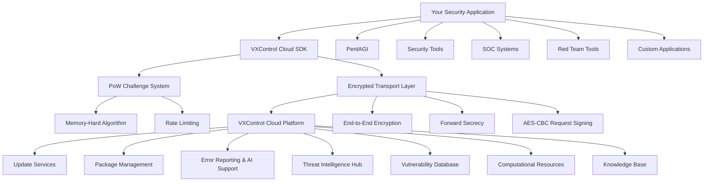

# VXControl Cloud SDK

<div align="center" style="font-size: 1.5em; margin: 20px 0;">
    Enterprise-grade Go SDK for secure integration with VXControl Cloud Intelligence Platform and Services.
</div>
<br>
<div align="center">

> 🚀 **Join the Community!** Connect with security researchers, AI enthusiasts, and fellow ethical hackers. Get support, share insights, and stay updated with the latest PentAGI developments.

[](https://discord.gg/2xrMh7qX6m)⠀[](https://t.me/+Ka9i6CNwe71hMWQy)

</div>

## Overview

The VXControl Cloud SDK enables developers to integrate their security tools and applications with the VXControl Cloud Intelligence Platform, providing access to advanced cybersecurity services including threat intelligence, vulnerability databases, computational resources, AI-powered troubleshooting, and automated update systems.

## Key Features

- **Type-Safe API**: 24 strongly-typed function patterns covering all request/response scenarios
- **Transparent Security**: Automatic proof-of-work solving and end-to-end encryption
- **Performance Optimized**: HTTP/2 support, connection pooling, streaming encryption
- **Enterprise Ready**: Comprehensive error handling, retry logic, and production monitoring
- **License Integration**: Built-in premium feature validation and tier management
- **Endpoint Health Probing**: `Check()` API for pre-flight connectivity and quota verification
- **Structured Rate Limit Errors**: `RateLimitError` / `QuotaError` carry server-advertised `Retry-After` cooldowns
- **Context-Safe Retries**: Cancelled context during back-off preserves the last `*RateLimitError` so callers can still read `RetryAfter`

## Quick Start

### Installation

```bash
go get github.com/vxcontrol/cloud/sdk
```

The module requires Go 1.26.5 or later. Build with the latest patch release: the SDK speaks the HTTP/2 of the standard library, so its security fixes come with the toolchain.

### Basic Usage

```go
package main

import (
    "context"
    "encoding/json"
    "log"

    "github.com/vxcontrol/cloud/models"
    "github.com/vxcontrol/cloud/sdk"
    "github.com/vxcontrol/cloud/system"

    "github.com/sirupsen/logrus"
)

type Client struct {
    UpdatesCheck  sdk.CallReqBytesRespBytes
    ReportError   sdk.CallReqBytesRespBytes
}

func main() {
    var client Client

    // Configure endpoints
    configs := []sdk.CallConfig{
        {
            Calls:  []any{&client.UpdatesCheck},
            Host:   "update.pentagi.com",
            Name:   "updates_check",
            Path:   "/api/v1/proxy/updates/check",
            Method: sdk.CallMethodPOST,
        },
        {
            Calls:  []any{&client.ReportError},
            Host:   "support.pentagi.com",
            Name:   "errors_report",
            Path:   "/api/v1/proxy/errors/report",
            Method: sdk.CallMethodPOST,
        },
    }

    // Initialize SDK
    err := sdk.Build(configs,
        sdk.WithClient("MySecTool", "1.0.0"),
        sdk.WithInstallationID(system.GetInstallationID()),
        sdk.WithLogger(sdk.WrapLogrus(logrus.StandardLogger())),
        sdk.WithLicenseKey("XXXX-XXXX-XXXX-XXXX"),
    )
    if err != nil {
        log.Fatal("SDK initialization failed:", err)
    }

    // Check for updates. Strategy is required — it tells the server whether to
    // resolve components against a curated release ("stable"), a release plus
    // channel metadata ("preview"), or the raw channel alone ("nightly").
    updateReq := models.CheckUpdatesRequest{
        InstallerVersion: "1.0.0",
        InstallerOS:      models.OSTypeLinux,
        InstallerArch:    models.ArchTypeAMD64,
        Strategy:         models.UpdateStrategyStable,
    }

    data, _ := json.Marshal(updateReq)
    response, err := client.UpdatesCheck(context.Background(), data)
    if err != nil {
        log.Fatal("Update check failed:", err)
    }

    // Every response body arrives wrapped in {"status":…,"data":…}. Decoding it
    // straight into CheckUpdatesResponse "succeeds" and silently yields an empty
    // update list — always unwrap it with ParseEnvelope instead.
    updateResp, err := models.ParseEnvelope[models.CheckUpdatesResponse](response)
    if err != nil {
        log.Fatal("Update check failed:", err)
    }
    log.Printf("Available updates: %+v", updateResp.Updates)
}
```

## Architecture



## Cloud Services Integration

### Update Management
Keep PentAGI with automated update checking:

```go
import "github.com/vxcontrol/cloud/models"

// Check for component updates. Installed artefacts are reported separately by
// how they are delivered: pulled container images vs. downloaded files.
// Report every product stack you know about too, including unused ones — a
// stack hosted externally and a stack nobody uses look identical otherwise.
updateReq := models.CheckUpdatesRequest{
    InstallerVersion: "1.0.0",
    InstallerOS:      models.OSTypeLinux,
    InstallerArch:    models.ArchTypeAMD64,
    Strategy:         models.UpdateStrategyStable,
    Images: []models.ImageComponentInfo{
        {
            Component:  models.ComponentTypePentagi,
            Status:     models.ComponentStatusRunning,
            OS:         models.OSTypeLinux, // the ARTEFACT's platform, not the host's
            Arch:       models.ArchTypeAMD64,
            Repository: "vxcontrol/pentagi",
            Tag:        "latest",
        },
    },
    Stacks: []models.StackInfo{
        {Stack: models.ProductStackPentagi, Status: models.StackStatusInstalled},
    },
}

data, _ := json.Marshal(updateReq)
response, err := client.UpdatesCheck(ctx, data)

updateResp, err := models.ParseEnvelope[models.CheckUpdatesResponse](response)
```

### Error Reporting & AI Support
Get intelligent assistance for troubleshooting:

```go
// Report an error for analysis
errorReq := models.SupportErrorRequest{
    Component:    models.ComponentTypePentagi,
    Version:      "1.0.0",
    OS:          models.OSTypeLinux,
    Arch:        models.ArchTypeAMD64,
    ErrorDetails: map[string]any{
        "error_type": "connection_timeout",
        "message":    "Failed to connect to target",
        "context":    map[string]string{"target": "192.168.1.1", "port": "443"},
    },
}

data, _ := json.Marshal(errorReq)
response, err := client.ReportError(ctx, data)
```

### Package Management
Download and validate software packages:

```go
// Get package information
packageReq := models.PackageInfoRequest{
    Component: models.ComponentTypePentagi,
    Version:   "1.0.0",
    OS:        models.OSTypeLinux,
    Arch:      models.ArchTypeAMD64,
}

// Validate package integrity with signatures
signature := models.SignatureValue("base64-encoded-signature")
fileData, _ := os.ReadFile("package.tar.gz")
if err := signature.ValidateData(fileData); err != nil {
    log.Fatal("Package signature validation failed:", err)
}
```

### AI-Powered Troubleshooting
Interactive support with investigation capabilities:

```go
// Create support issue. ErrorDetails may be any JSON value; the support assistant
// reads a models.SupportIssueDetails document as the context of the issue (see
// "Support Issues" below for it, the limits of an issue and its status).
issueReq := models.SupportIssueRequest{
    Component:    models.ComponentTypeEngine,
    Version:      "2.0.0",
    OS:          models.OSTypeDarwin,
    Arch:        models.ArchTypeARM64,
    ErrorDetails: "Scanner fails to detect specific vulnerability patterns",
    Logs: []models.SupportLogs{
        {
            Component: models.ComponentTypeEngine,
            Logs:      []string{"ERROR: Pattern matching timeout", "WARN: Memory usage high"},
        },
    },
}

// Investigate with AI assistance. IssueID is the value returned by the
// SupportIssueResponse above — it is how a client keeps a multi-turn
// conversation about the same issue across separate calls.
investigationReq := models.SupportInvestigationRequest{
    IssueID:   receivedIssueID,
    UserInput: "The scanner works fine with other patterns but fails on this specific CVE",
}

// Bind IssueInvestigate to CallReqBytesRespBytes for the default JSON answer:
data, _ := json.Marshal(investigationReq)
response, err := client.IssueInvestigate(ctx, data)
answer, err := models.ParseEnvelope[models.SupportInvestigationResponse](response)
// answer.Answer is the reply text; answer.MsgLogs carries the full anonymised
// conversation transcript when the server attaches one.

// Or set UseStream and bind a second field of the same endpoint (here
// IssueInvestigateStream) to CallReqBytesRespReader, to receive the same answer
// incrementally as an event stream — like the answer of an LLM call, the stream
// is NOT wrapped in the {"status":…,"data":…} envelope every JSON response has.
investigationReq.UseStream = true
data, _ = json.Marshal(investigationReq)
stream, err := client.IssueInvestigateStream(ctx, data)
if err != nil {
    return err // refused before the stream began: the usual errors of the sdk package
}
defer stream.Close()

// sse.Read hands over `start` and the events of the call, and returns nil only for
// a stream that ended with `done`. A refusal inside the stream is an *sse.Error matched by
// errors.Is against the same sdk errors; a lost connection is sse.ErrStreamCut.
err = sse.Read(stream, sdk.ErrorFromCode, func(event sse.Event) error {
    switch event.Name {
    case models.SupportStreamEventContent.String():
        var content models.SupportStreamContent
        if err := json.Unmarshal(event.Data, &content); err != nil {
            return err
        }
        fmt.Print(content.Content)
    }
    return nil
})
```

### Reading an event stream

A streamed answer is a sequence of frames, each an event name and one JSON value on one line:

```text
event: start
data: {"issue_id":"7f1e4c9a-0b52-4d0e-9c53-2f6a1d3b8e10"}

event: heartbeat
data: {"timestamp":1781092800}

event: content
data: {"content":"Based on the logs","stream_id":1}

event: flush
data: {"stream_id":1}

event: update
data: {"content":"Based on the logs","stream_id":1,"thinking":null}

event: done
data: {}
```

It opens with `start`, carries `heartbeat` frames that keep the connection alive and the events of the call, and ends with exactly one of `done` and `error`. Three rules follow, and `sdk/sse` enforces them so a caller cannot get them wrong:

- **An answer is complete if and only if `done` arrived.** The transport ends a broken response the way it ends a whole one, so the end of the body proves nothing.
- **`error` is a refusal of the server**, with the code a refusal answered before the response began would have carried: `{"code":"Internal","message":"internal server error"}`. Given `sdk.ErrorFromCode`, the reader returns an `*sse.Error` that `errors.Is` and `errors.As` match exactly as they match the error of a refused call.
- **The end of the body before either is a cut stream** (`sse.ErrStreamCut`). What was read is not an answer, and the request must not be sent again because of it: the server may have done the work.

A handler receives `start` and the events of the call; the reader consumes the heartbeats and reports `done` and `error` as the outcome of the read. An event whose name a handler does not know is skipped: a newer server may send more.

The events of the support assistant are `message`, `thinking`, `content`, `flush` and `update` (`models.SupportStreamEvent`, with a payload type each). For one model call they arrive in that order: `thinking` and `content` deltas, `flush` when the deltas have ended, then `update` with the whole answer of the call. Every attempt of a model call has a `stream_id` of its own: an attempt that failed and was tried again leaves deltas with no `update` behind them, and the next attempt streams under the next id — take the answer of a call from its `update`, not from deltas whose `stream_id` never got one. `thinking` carries the reasoning of a model as `models.SupportReasoning` — the text and the signature some providers require back on the next turn — in the wire form of langchaingo's `reasoning.ContentReasoning`.

### Language Models

A licence with Cloud LLM calls the language models of the API as agents: `model` in a request names an agent, and the agent decides the model behind it, what a request may set and how large it may be. `llm.Client` makes those calls for a library of the OpenAI API: the library is given `llm.BaseURL` and the client as its HTTP client, and sends what it always sends.

```go
client, err := llm.New("features.pentagi.com", sdk.WithLicenseKey(licenseKey))
if err != nil {
    return err
}
agents, err := client.Models(ctx) // the agents of the licence, with their bounds
// e.g. langchaingo: openai.New(openai.WithBaseURL(llm.BaseURL), openai.WithHTTPClient(client),
//     openai.WithToken("unused"), openai.WithModel("pentagi.coder"))
// the library wants a token; any value will do: the client reads no header of a request
```

The list of agents (`models.LLMModelsResponse`) is the list object of the OpenAI API, each agent a model object of it: `id` is the name to send in `model`, `created` when the agent was created (Unix seconds), `owned_by` is `"pentagi"`. Beside them each agent says what a caller needs to call it: `type` (`completion` or `embedding`), `description`, `context_window` of the model that serves the licence, `max_output_tokens` (the most output a request may ask for), `max_input_size` (the largest body of a request, in bytes), and `supported_parameters` — the request parameters a caller may set, always a list, `[]` for none; the rest of a request is the agent's and is not used, and both spellings of the output limit are listed where one is taken. An agent of embeddings adds `dimensions` and `max_batch_size`. `Models` refuses a list that is not valid in every field rather than reading it as fewer agents.

```json
{"object":"list","data":[
  {"id":"pentagi.coder","object":"model","created":1781092800,"owned_by":"pentagi","type":"completion","description":"Coder","context_window":131072,"max_output_tokens":8192,"max_input_size":2097152,"supported_parameters":["max_completion_tokens","max_tokens","response_format","temperature","tool_choice","tools"]},
  {"id":"pentagi.embedding","object":"model","created":1781092800,"owned_by":"pentagi","type":"embedding","max_input_size":2097152,"supported_parameters":[],"dimensions":1024,"max_batch_size":64}
]}
```

The answer of an LLM call is an event stream of its own: `chunk` events, each one `chat.completion.chunk` of the OpenAI API, for a streamed chat completion, and one `result` for any other call. The client turns it back into what the OpenAI API answers — the `data:` frames ending with `data: [DONE]`, or the one object — and reports a failure with the errors of the SDK: before the answer began as the error of the call, inside a stream as the error of a read of its body. A streamed call is answered once its first chunk has arrived, so that a refusal before it — the API refuses everything but a broken stream before the first chunk — is the error of the call as well, as an OpenAI-compatible endpoint answers it with its status. A call whose answer has begun is never sent again: a stream that was cut is not an answer, and the model may have done the work. A refusal before the answer that may pass — a busy model or a rate (429), 502, 500 — is tried again by the SDK as any call is, up to `sdk.WithMaxRetries` (3 by default): give `llm.New` `sdk.WithMaxRetries(1)` when the library tries again on its own. An embeddings batch larger than the `max_batch_size` of its agent — a library of the OpenAI API sends as many inputs as it was given — is sent by the client in parts of that size, one after another, and answered as one list: the vectors in the order of the inputs, the usage added up. The bound comes from the list of agents, read once for five minutes; when the list cannot be read again the bound read before stands for another five. The client reads the list itself before the first batch; a batch of an agent the list does not name, or sent while the list cannot be read and none was read before, goes whole. A part that fails ends the call with its error, and the parts before it were served.

### Licence Status

A licensed installation reads what its licence gives it — the tier, the features it enables and the share used of each of its quotas of the support assistant and of Cloud LLM — from the endpoint `license_status`: `GET /api/v1/proxy/license/status` on `update.pentagi.com`, with no request body. The SDK knows no endpoints, so the caller builds the call as it builds the update check; `Name` is the code of the endpoint, and neither it nor the path is the caller's to choose.

```go
var licenseStatus sdk.CallReqRespBytes
err := sdk.Build([]sdk.CallConfig{{
    Calls:  []any{&licenseStatus},
    Host:   "update.pentagi.com",
    Name:   "license_status",
    Path:   "/api/v1/proxy/license/status",
    Method: sdk.CallMethodGET,
}},
    sdk.WithClient("MySecTool", "1.0.0"),
    sdk.WithInstallationID(system.GetInstallationID()),
    sdk.WithLicenseKey(licenseKey),
)
if err != nil {
    return err
}

body, err := licenseStatus(ctx)
if err != nil {
    return err // the errors of the sdk package
}
status, err := models.ParseEnvelope[models.LicenseStatusResponse](body)
if err != nil {
    return err
}
if err := status.Valid(); err != nil {
    return err // not a status: never show it as a licence with nothing used
}
```

```json
{"tier":"enterprise","features":{"updates":true,"support":true,"knowledge_base":false,"cloud_llm":true},"quotas":[
  {"limit":"llm_agent","daily":{"requests":-1},"monthly":{"requests":-1}},
  {"limit":"llm_automation","daily":{"requests":100},"monthly":{"requests":30}},
  {"limit":"llm_completion","daily":{"requests":1,"tokens":13},"monthly":{"requests":1,"tokens":4}},
  {"limit":"llm_embedding","daily":{"requests":0,"tokens":0},"monthly":{"requests":1,"tokens":2}}
]}
```

`tier` is the tier of the licence. `features` are what it enables — `updates`, `support`, `knowledge_base` and `cloud_llm`, the last as it is served: false for a licence whose tier is not served Cloud LLM, even when its key carries the flag. `quotas` names each limit (`models.LicenseQuotaLLMAgent` and the other known names; a limit added later is read by its name like these) with its use `daily`, today as a UTC day, and `monthly`, this month of the licence, counted from the day of the month its first key was issued. The overrides of the licence are applied: the numbers are measured against the ceilings the API enforces for this licence. The server computes them; a client only reads them:

- **A share is a whole percent of the quota used.** `0` is nothing used, any use is at least `1`, a share between is rounded down and stays below `100`, and `100` is a quota used up: the next call of that limit is refused with `sdk.ErrQuotaExceededDaily` or `sdk.ErrQuotaExceededMonthly`.
- **`-1` (`models.LicenseQuotaUnlimited`) is no ceiling** in that period, however much is used. It is a value, not an error: test for it before drawing a share.
- **`requests` is the share of the calls; `tokens` is the larger of the shares of the input and of the output tokens** — `-1` only when neither has a ceiling — and is absent (`Tokens == nil`) for a limit that meters no tokens. Absent is not `0`: `0` is a limit that meters tokens and has used none.
- **The list holds the limits of the support assistant and of Cloud LLM** (`llm_agent`, `llm_automation`, `llm_completion`, `llm_embedding`, and a name added later): one of them not in the list is a limit the licence cannot call, or calls with no quota kept, and its absence says nothing of its use. The quotas of other calls — update checks, downloads, the status and the messages of an issue — are never in it. `quotas` is `[]` for none, never null.

`Valid` refuses a share outside `-1`…`100`, a quota without its name, and a status without its tier or its list — which is what a body of any other shape decodes into. The endpoint counts against no quota and has rate limits of its own per licence, shared by its installations: read the status every few hours and when someone asks for it, keep the last one, and after a `*sdk.RateLimitError` ask again no sooner than `sdk.RetryAfterOf(err)`. A licence the API does not serve is refused, either as `sdk.ErrForbidden` or as `sdk.ErrQuotaBlocked` (a `*sdk.QuotaError`): read both as the licence not served, not as a failure to retry. A key `sdk.WithLicenseKey` did not take is refused as `sdk.ErrForbidden` too — a key that does not decode or has expired is not sent at all. The term of a licence is in its key, not in the status: read it locally with `sdk.IntrospectLicenseKey(key)` (`ExpiredAt`, `IsExpired()`) and do not call with an expired key.

### Support Issues

An issue is created once and then addressed by the ID the creation answers: its status, its conversation, and one question at a time. The four endpoints are on `support.pentagi.com`; as for every call, `Name` is the code of the endpoint, and neither it nor the path is the caller's to choose. The status and the messages take the ID of the issue as the argument of the path, and the question binds both forms of its answer to one config:

```go
var client struct {
    IssueCreate            sdk.CallReqBytesRespBytes
    IssueStatus            sdk.CallReqWithArgsRespBytes
    IssueMessages          sdk.CallReqWithArgsRespBytes
    IssueInvestigate       sdk.CallReqBytesRespBytes
    IssueInvestigateStream sdk.CallReqBytesRespReader
}
err := sdk.Build([]sdk.CallConfig{
    {Calls: []any{&client.IssueCreate}, Host: "support.pentagi.com", Name: "support_issues",
        Path: "/api/v1/proxy/support/issues", Method: sdk.CallMethodPOST},
    {Calls: []any{&client.IssueStatus}, Host: "support.pentagi.com", Name: "support_issue_status",
        Path: "/api/v1/proxy/support/issues/:issueID/status", Method: sdk.CallMethodGET},
    {Calls: []any{&client.IssueMessages}, Host: "support.pentagi.com", Name: "support_issue_messages",
        Path: "/api/v1/proxy/support/issues/:issueID/messages", Method: sdk.CallMethodGET},
    {Calls: []any{&client.IssueInvestigate, &client.IssueInvestigateStream}, Host: "support.pentagi.com",
        Name: "support_investigate", Path: "/api/v1/proxy/support/investigate", Method: sdk.CallMethodPOST},
}, options...)
```

**Reporting an issue.** `error_details` may be any JSON value, and the server keeps it as it arrived. The support assistant reads a `models.SupportIssueDetails` document as the context of the issue: what the user wrote about the problem (`description` — a report of what does not work, not a question) and what the product can tell about itself, its host, its licence, its providers, the flow concerned and the logs it sent. The schema is versioned by `Schema` (now `1`) and grows by adding fields. Anonymise the document and the logs, check them, and write the request without escaping HTML:

```go
details := models.SupportIssueDetails{
    Schema:      1,
    Description: description, // what does not work, in the words of the user
    CollectedAt: time.Now().UTC(),
    Product:     models.SupportIssueProduct{Version: "1.2.0", OS: runtime.GOOS, Arch: runtime.GOARCH},
    Logs:        models.SupportIssueLogs{Available: true, Lines: len(lines)},
}
if err := anon.Anonymize(&details); err != nil {
    return err
}
if err := anon.Anonymize(&lines); err != nil {
    return err
}
if err := details.Valid(); err != nil {
    return err // after Anonymize: a marker can be longer than the text it replaced
}

issue := models.SupportIssueRequest{
    Component:    models.ComponentTypePentagi,
    Version:      "1.2.0",
    OS:           models.OSTypeLinux,
    Arch:         models.ArchTypeAMD64,
    Logs:         []models.SupportLogs{{Component: models.ComponentTypePentagi, Logs: lines}},
    ErrorDetails: details,
}
if err := issue.Valid(); err != nil {
    return err // the limits of the server on the lines and on error_details
}

var body bytes.Buffer
encoder := json.NewEncoder(&body)
encoder.SetEscapeHTML(false) // json.Marshal writes each <, > and & of tool output as six bytes
if err := encoder.Encode(issue); err != nil {
    return err
}
if body.Len() > models.MaxSupportIssueRequestBytes {
    return errIssueTooLarge // the one limit Valid cannot see
}

response, err := client.IssueCreate(ctx, body.Bytes())
if err != nil {
    return err
}
created, err := models.ParseEnvelope[models.SupportIssueResponse](response)
```

The server refuses a body larger than `models.MaxSupportIssueRequestBytes` (2 MiB), more than `models.MaxSupportIssueLogLines` (2000) lines of logs over all components together, a line outside 1–8192 characters, and `error_details` larger than `models.MaxSupportIssueDetailsBytes` (256 KiB) as compact JSON with `<`, `>` and `&` written as themselves, however they were escaped on the wire. `SupportIssueDetails.Valid` holds the bounds of the document: `schema` at least 1, a `description` of at most 4000 characters, at most 32 providers, 64 findings, 32 skipped parts, and in the flow 10 functions, 10 models and 30 errors. The fields of closed vocabularies, versions and references carry `anonymizer:"skip"`, so `Anonymize` replaces only the free text and leaves them as a reader matches them. Every part, field and bound is described in [API.md](API.md#support-issue-format).

**Status and conversation.** The status says what runs on an issue; `UpdatedAt` says when its conversation last changed. The answer of a turn is written after the last move of `UpdatedAt`, before the status returns to `processed`: read the messages when `UpdatedAt` moved, and once more when the status leaves `answering`:

```go
body, err := client.IssueStatus(ctx, []string{issueID.String()})
if err != nil {
    return err
}
status, err := models.ParseEnvelope[models.SupportIssueStatusResponse](body)
if err != nil {
    return err
}
if err := status.Valid(); err != nil {
    return err // not a status: never wait on it
}
moved := status.UpdatedAt != nil && !status.UpdatedAt.Equal(lastUpdatedAt)
leftAnswering := lastStatus == models.SupportIssueStatusAnswering && status.Status != models.SupportIssueStatusAnswering
if moved || leftAnswering {
    body, err := client.IssueMessages(ctx, []string{issueID.String()})
    if err != nil {
        return err
    }
    conversation, err := models.ParseEnvelope[models.SupportIssueMessagesResponse](body)
    // ...
}
```

- **`processing`, `processed`, `answering`.** An issue is `processing` from its creation while the server works through the lines of logs it was reported with, and `processed` from the start when there are none; processing ends in `processed` whatever its outcome — there is no failed status. A question moves the issue to `answering` and back to `processed`, which it is again before the last frame of the answer is written: a status read after the `done` of one's own stream does not show that question still running. The status is kept by the server, not by a connection: a turn this caller did not send reads `answering` too.
- **`UpdatedAt` moves with the conversation** — a question asked, a call of the model — to the microsecond, and is absent before the first question; the answer of a turn is written after its last move. The messages (`SupportIssueMessagesResponse`) are the questions (`input`), the steps of the assistant and its answers (`done`), `[]` before the first question, never null. A stream carries the answer as `content` and `update` events, not as a `done` message; after a stream that was cut, wait for `processed` and read the messages: they hold what the turn got to answer.
- **A question is taken only while the issue is `processed`**, one at a time whoever sends it. At any other time it is refused before the stream begins with the code `Support.Busy`, and the refusal costs no quota: wait for `processed` and ask again. The status is a hint, not a gate: a question sent while the status cannot be read is judged by the server.
- **An issue belongs to the licence that created it**, not to the installation that sent it: every installation of the licence reads it and asks about it, also after the key of the licence was regenerated. An issue of another licence is `Support.NotFound`, as one that does not exist. A licence whose features do not include `support` is refused on all four endpoints, as `sdk.ErrForbidden` or as `sdk.ErrQuotaBlocked`: read both as support not served, not as a failure to retry.
- **The codes of support are not sentinels of the SDK.** `Support.NotFound` (404), `Support.Busy` (409), `Support.InvalidRequest` (400, a request that cannot be read) and `Support.InvalidData` (500, a request that is not valid) reach the caller as an error that matches `sdk.ErrRequestFailed` and whose message begins with the code (`Support.Busy: request execution failed`); inside a stream the code is the `Code` of the `*sse.Error`. `errors.Is(err, sdk.ErrNotFound)` is false for an unknown issue.
- **Poll the status sparingly.** It has rate limits of its own per licence and, on some tiers, a quota of its own, apart from those of the questions and the messages; the licence status does not report it. Poll it while the issue is `processing` or `answering` — every 30 seconds is enough — and seldom otherwise, and after a `*sdk.RateLimitError` or a `*sdk.QuotaError` not before `sdk.RetryAfterOf(err)`.

## Call Function Types

The SDK generates 24 strongly-typed function patterns, one for every combination of request shape (none / query / path args / query+args), request body (none / bytes / reader), and response shape (bytes / reader / writer). Assign the field a value of one of these types and `sdk.Build` fills it in for the `CallConfig` it matches:

| Pattern | Request | Body | Response | Use Case |
|---------|---------|------|----------|----------|
| `CallReqRespBytes` | None | None | Bytes | Simple JSON/binary retrieval |
| `CallReqRespReader` | None | None | Reader | Large downloads as a stream |
| `CallReqRespWriter` | None | None | Writer | Stream a response into an `io.Writer` |
| `CallReqQueryRespBytes` | Query | None | Bytes | Filtered queries (`?limit=10&offset=20`) |
| `CallReqQueryRespReader` | Query | None | Reader | Query-based downloads |
| `CallReqQueryRespWriter` | Query | None | Writer | Query-based streaming (used by `download-installer`) |
| `CallReqWithArgsRespBytes` | Path args | None | Bytes | RESTful resource access (`/users/:id`) |
| `CallReqWithArgsRespReader` | Path args | None | Reader | Resource-specific downloads |
| `CallReqWithArgsRespWriter` | Path args | None | Writer | Resource-specific streaming |
| `CallReqQueryWithArgsRespBytes` | Path args + Query | None | Bytes | Combined path + query lookups |
| `CallReqQueryWithArgsRespReader` | Path args + Query | None | Reader | Combined lookups, streamed response |
| `CallReqQueryWithArgsRespWriter` | Path args + Query | None | Writer | Combined lookups streamed to a writer |
| `CallReqBytesRespBytes` | None | Bytes | Bytes | JSON API calls (used by `check-update`, `report-errors`) |
| `CallReqBytesRespReader` | None | Bytes | Reader | JSON request, SSE/streamed response (AI investigation) |
| `CallReqBytesRespWriter` | None | Bytes | Writer | JSON request, response streamed to a writer |
| `CallReqReaderRespBytes` | None | Reader | Bytes | Streamed upload, JSON response |
| `CallReqReaderRespReader` | None | Reader | Reader | Stream-to-stream processing |
| `CallReqReaderRespWriter` | None | Reader | Writer | Streamed upload with streamed output |
| `CallReqBytesWithArgsRespBytes` | Path args | Bytes | Bytes | Resource updates with a JSON body |
| `CallReqBytesWithArgsRespReader` | Path args | Bytes | Reader | Resource updates with a streamed response |
| `CallReqBytesWithArgsRespWriter` | Path args | Bytes | Writer | Resource updates streamed to a writer |
| `CallReqReaderWithArgsRespBytes` | Path args | Reader | Bytes | Streamed uploads to a specific resource |
| `CallReqReaderWithArgsRespReader` | Path args | Reader | Reader | Resource-targeted stream processing |
| `CallReqReaderWithArgsRespWriter` | Path args | Reader | Writer | Resource-targeted streamed upload/download |

> **Note:** only calls with a `[]byte` body (`*Bytes*` variants) are retried automatically on a temporary failure — see [Automatic Retry Logic](#automatic-retry-logic). A call built with a raw `io.Reader` body cannot be rewound after a failed attempt, so the SDK disables retries for it.

[Complete function reference](https://pkg.go.dev/github.com/vxcontrol/cloud/sdk)

## Configuration Options

### Basic Configuration

```go
err := sdk.Build(configs,
    // Required: Client identification
    sdk.WithClient("MyApp", "1.0.0"),

    // Optional: Premium features
    sdk.WithLicenseKey("XXXX-XXXX-XXXX-XXXX"),

    // Optional: Performance tuning
    sdk.WithPowTimeout(30*time.Second),
    sdk.WithMaxRetries(3),
)
```

### Advanced Configuration

```go
// Custom transport for proxies/certificates
transport := sdk.DefaultTransport()
transport.TLSClientConfig = &tls.Config{
    MinVersion: tls.VersionTLS12,
    // custom certificate validation
}
transport.Proxy = http.ProxyURL(proxyURL)

// Custom structured logging
logger := logrus.New()
logger.SetLevel(logrus.InfoLevel)

err := sdk.Build(configs,
    sdk.WithTransport(transport),
    sdk.WithLogger(sdk.WrapLogrus(logger)),
    sdk.WithInstallationID(system.GetInstallationID()),
)
```

## Security Model

### Proof-of-Work Protection
All API calls require solving computational challenges to prevent abuse and DDoS attacks. The SDK automatically:
- Requests challenge tickets from the server
- Solves memory-hard proof-of-work puzzles
- Includes cryptographic signatures with requests

### End-to-End Encryption
- **Session Keys**: Ephemeral AES keys for each request
- **NaCL Encryption**: Secure key exchange using Curve25519
- **Streaming Cipher**: AES-GCM for large data transfers
- **Forward Secrecy**: Cypher key rotation

### Rate Limiting Integration
- **Adaptive Difficulty**: PoW complexity scales with server load
- **Tier-Based Access**: License validation determines API quotas
- **Intelligent Retry**: Automatic backoff with server-provided timing

## Error Handling

### Error Type Hierarchy

The SDK defines three layers of errors:

1. **Sentinel errors** — comparable with `errors.Is`, e.g. `sdk.ErrTooManyRequestsRPM`
2. **Wrapper types** — carry extra fields, extractable with `errors.As`:
   - `*sdk.RateLimitError` — wraps RPM/RPH/RPD/general rate-limit sentinels and carries the server-advertised `Retry-After` cooldown
   - `*sdk.QuotaError` — wraps license-tier quota sentinels (`Blocked`, `Daily`, `Monthly`) and carries the `Retry-After` reset cooldown
3. **Joined context errors** — when a context is cancelled during back-off, the SDK returns `fmt.Errorf("%w: %w", ctx.Err(), lastRateLimitErr)`, preserving both the context error and the rate-limit wrapper

### RetryAfterOf Helper

Use `sdk.RetryAfterOf(err)` to extract the server-suggested retry delay from any error, without needing to type-assert to `*RateLimitError` or `*QuotaError` directly:

```go
response, err := client.UpdatesCheck(ctx, data)
if err != nil {
    if wait := sdk.RetryAfterOf(err); wait > 0 {
        log.Printf("server asks to retry after %s", wait)
        time.Sleep(wait)
    }
}
```

### RateLimitError and QuotaError

```go
response, err := client.QueryThreats(ctx, body)
if err != nil {
    // Fine-grained rate-limit classification
    var rle *sdk.RateLimitError
    if errors.As(err, &rle) {
        switch rle.Scope {
        case sdk.RateLimitScopeRPM:
            // minute-window: SDK already retries automatically up to maxRetries
            time.Sleep(rle.RetryAfter)
        case sdk.RateLimitScopeRPH:
            // hour-window: fatal, do not auto-retry
            log.Printf("hourly limit reached, retry after %s", rle.RetryAfter)
        case sdk.RateLimitScopeRPD:
            // day-window: fatal, do not auto-retry
            log.Printf("daily limit reached, retry after %s", rle.RetryAfter)
        }
        return
    }

    // Quota / license-tier errors
    var qe *sdk.QuotaError
    if errors.As(err, &qe) {
        switch qe.Scope {
        case sdk.QuotaScopeBlocked:
            log.Println("endpoint not available for this license tier")
        case sdk.QuotaScopeDaily:
            log.Printf("daily quota exhausted, reset in %s", qe.RetryAfter)
        case sdk.QuotaScopeMonthly:
            log.Printf("monthly quota exhausted, reset in %s", qe.RetryAfter)
        }
        return
    }
}
```

### Automatic Retry Logic

```go
// Temporary errors (automatically retried up to WithMaxRetries):
// - Server overload (sdk.ErrBadGateway, sdk.ErrServerInternal)     → 3s backoff
// - General rate limits (sdk.ErrTooManyRequests)                   → 5s backoff
// - RPM rate limits (sdk.ErrTooManyRequestsRPM)                    → Retry-After header (capped at DefaultWaitTime=10s)
// - PoW timeouts (sdk.ErrExperimentTimeout)                        → DefaultWaitTime=10s backoff

// Fatal errors (no retry):
// - Invalid requests (sdk.ErrBadRequest, sdk.ErrForbidden, sdk.ErrNotFound)
// - Long-term rate limits (sdk.ErrTooManyRequestsRPH, sdk.ErrTooManyRequestsRPD)
// - Quota errors (sdk.ErrQuotaBlocked, sdk.ErrQuotaExceededDaily, sdk.ErrQuotaExceededMonthly)
```

The `calculateWaitTime` logic now **prefers the server-advertised `Retry-After`** value from `*RateLimitError` (capped at `DefaultWaitTime`) over fixed fallback delays.

> **Streamed request bodies are never retried.** Calls built with a raw `io.Reader` body (`CallReqReaderRespBytes` and its siblings) cannot be rewound after a failed attempt, so the SDK forces a single attempt for them regardless of `WithMaxRetries`. Calls with a `[]byte` body (`CallReqBytesRespBytes` and its siblings — what all three [examples](examples/) use) are retried normally: a fresh reader is created for every attempt.

### Custom Error Handling

```go
data, err := api.QueryThreats(ctx, []byte(threatQuery))
if err != nil {
    // Check for server-suggested retry delay first (works for both RateLimitError and QuotaError)
    if wait := sdk.RetryAfterOf(err); wait > 0 {
        log.Printf("server suggests waiting %s before retry", wait)
    }

    switch {
    case errors.Is(err, sdk.ErrTooManyRequestsRPM):
        // SDK already retried automatically; wait for server-advertised window
        time.Sleep(sdk.RetryAfterOf(err))

    case errors.Is(err, sdk.ErrQuotaBlocked):
        // Endpoint not available for current license tier, upgrade required
        log.Error("access denied — upgrade license tier")

    case errors.Is(err, sdk.ErrForbidden):
        // Check license validity or authentication
        log.Error("access denied - verify license key")

    case errors.Is(err, sdk.ErrExperimentTimeout):
        // Increase PoW timeout for slower systems
        // Reconfigure with sdk.WithPowTimeout(60*time.Second)

    default:
        log.Error("unexpected error:", err)
    }
}
```

## Endpoint Health Check

The `Check()` function probes each configured endpoint by acquiring and solving a PoW ticket **without making an actual API call**. Use it at startup or in health-check routines to verify reachability and inspect allowed RPM quotas.

### Basic Usage

```go
configs := []sdk.CallConfig{
    {Host: "update.pentagi.com", Name: "updates_check", Path: "/api/v1/proxy/updates/check", Method: sdk.CallMethodPOST},
    {Host: "support.pentagi.com", Name: "errors_report",  Path: "/api/v1/proxy/errors/report",  Method: sdk.CallMethodPOST},
}

ctx, cancel := context.WithTimeout(context.Background(), 10*time.Second)
defer cancel()

statuses, err := sdk.Check(ctx, configs,
    sdk.WithClient("MyApp", "1.0.0"),
    sdk.WithLicenseKey("XXXX-XXXX-XXXX-XXXX"),
)
if err != nil {
    log.Fatal("SDK setup failed:", err)
}

for name, s := range statuses {
    if s.IsReachable() {
        log.Printf("[%s] reachable, allowed RPM: %d", name, s.AllowedRPM())
    } else {
        log.Printf("[%s] unreachable: %v", name, s.LastError())
    }
}
```

### EndpointStatus Interface

`Check()` returns `sdk.EndpointStatuses` — a `map[string]EndpointStatus` keyed by endpoint `Name`. Each value exposes:

| Method | Description |
|--------|-------------|
| `LastError() error` | Last probe error, or `nil` on success |
| `AllowedRPM() int` | Server-advertised requests-per-minute quota (0 when unreachable) |
| `IsReachable() bool` | `true` when last probe succeeded and `AllowedRPM > 0` |
| `Recheck(ctx) error` | Re-probes the endpoint in place and updates all fields atomically |

```go
// Re-probe a specific endpoint later (e.g. after a rate-limit cooldown)
if err := statuses["updates_check"].Recheck(ctx); err != nil {
    log.Println("still unreachable:", err)
} else {
    log.Println("now reachable, RPM:", statuses["updates_check"].AllowedRPM())
}
```

### Error Classification in Check

Top-level errors from `Check()` indicate SDK setup failures (crypto, invalid options). Per-endpoint failures are stored inside each `EndpointStatus` and use the same error sentinel hierarchy as regular calls:

```go
s := statuses["errors_report"]
switch {
case s.LastError() == nil:
    // reachable
case errors.Is(s.LastError(), sdk.ErrInvalidConfiguration):
    log.Println("bad config — fix CallConfig")
case errors.Is(s.LastError(), sdk.ErrQuotaBlocked):
    log.Println("endpoint not available for this license tier")
case errors.Is(s.LastError(), sdk.ErrForbidden):
    log.Println("license key rejected by server")
default:
    log.Println("network/server error:", s.LastError())
}
```

## Performance Characteristics

### Benchmarks
- **License validation**: ~334,000 operations/sec
- **Function generation**: ~2M path templates/sec
- **Streaming encryption**: ~50MB/sec throughput
- **Connection pooling**: 300 connections/host, 50 total idle

### Memory Usage
- **Per request**: ~300 bytes (context + headers + keys)
- **Per SDK instance**: ~200KB (connection pools + crypto keys)
- **PoW solving**: 20-1024KB (reused across attempts)

### Optimization Tips

```go
// Reuse SDK instances across requests
err := sdk.Build(configs, options...)

// Use streaming for large data
reader, err := api.ProcessLargeDataset(ctx, dataStream, dataSize)

// Configure connection pooling for high throughput
transport := sdk.DefaultTransport()
transport.MaxConnsPerHost = 500
sdk.WithTransport(transport)
```

## Production Deployment

### Required Configuration

```go
// Minimum production setup
err := sdk.Build(configs,
    sdk.WithClient("YourApp", version),    // Required: Identification
    sdk.WithLicenseKey(licenseKey),        // Optional: Authentication
    sdk.WithLogger(productionLogger),      // Recommended: Monitoring
)
```

### Monitoring Integration

```go
// Custom logger for metrics collection
type MetricsLogger struct {
    *logrus.Logger
    metrics MetricsCollector
}

func (m *MetricsLogger) WithError(err error) sdk.Entry {
    // Track error rates by type
    m.metrics.IncrementErrorCounter(err)
    return m.Logger.WithError(err)
}

// Integration
logger := &MetricsLogger{Logger: logrus.New(), metrics: yourMetrics}
sdk.WithLogger(logger)
```

### Security Considerations

- **Certificate Validating**: Validate server certificates in production
- **Proxy Support**: Configure corporate proxy settings if required
- **Timeout Tuning**: Adjust PoW timeouts based on hardware capabilities
- **Rate Limit Monitoring**: Track API quota usage and plan capacity

## Use Cases

### Security Tool Integration

```go
// Integrate update checking into security tools
func checkSecurityToolUpdates(
    images []models.ImageComponentInfo, files []models.FileComponentInfo,
) error {
    updateReq := models.CheckUpdatesRequest{
        InstallerVersion: getCurrentVersion(),
        InstallerOS:      getCurrentOS(),
        InstallerArch:    getCurrentArch(),
        Strategy:         models.UpdateStrategyStable,
        Images:           images,
        Files:            files,
    }

    data, _ := json.Marshal(updateReq)
    response, err := client.UpdatesCheck(context.Background(), data)
    if err != nil {
        return err
    }

    updateResp, err := models.ParseEnvelope[models.CheckUpdatesResponse](response)
    if err != nil {
        return err
    }

    for _, update := range updateResp.Updates {
        if !update.HasUpdate {
            continue
        }
        // CurrentVersion/LatestVersion are only set when the server could
        // attribute the stack to a release — read Resolution to see why when
        // they are nil (e.g. an installation ahead of any curated release).
        log.Printf("Update available for stack %s (resolved via %s)", update.Stack, update.Resolution)
    }

    return nil
}
```

### Automated Error Reporting

```go
// Integrate error reporting into application error handling
func reportSecurityToolError(component models.ComponentType, err error) error {
    errorReq := models.SupportErrorRequest{
        Component:    component,
        Version:      getComponentVersion(component),
        OS:          getCurrentOS(),
        Arch:        getCurrentArch(),
        ErrorDetails: map[string]any{
            "error_message": err.Error(),
            "stack_trace":   getStackTrace(),
            "context":       getCurrentContext(),
        },
    }

    data, _ := json.Marshal(errorReq)
    _, reportErr := client.ReportError(context.Background(), data)
    return reportErr
}
```

### Package Integrity Validation

```go
// Validate downloaded packages before installation
func validatePackageIntegrity(packagePath, signatureStr string) error {
    signature := models.SignatureValue(signatureStr)

    // Validate file signature
    if err := signature.ValidateFile(packagePath); err != nil {
        return fmt.Errorf("package signature validation failed: %w", err)
    }

    log.Println("Package integrity verified successfully")
    return nil
}

// Validate data integrity in memory
func validateDataIntegrity(data []byte, signatureStr string) error {
    signature := models.SignatureValue(signatureStr)

    if err := signature.ValidateData(data); err != nil {
        return fmt.Errorf("data signature validation failed: %w", err)
    }

    return nil
}
```

## Advanced Features

### Multiple Service Endpoints

```go
// Connect to different service clusters
type FullClient struct {
    UpdatesCheck     sdk.CallReqBytesRespBytes
    ErrorReport      sdk.CallReqBytesRespBytes
    PackageInfo      sdk.CallReqBytesRespBytes
    SupportIssue     sdk.CallReqBytesRespBytes
}

configs := []sdk.CallConfig{
    {
        Calls:  []any{&client.UpdatesCheck},
        Host:   "update.pentagi.com",
        Name:   "updates_check",
        Path:   "/api/v1/proxy/updates/check",
        Method: sdk.CallMethodPOST,
    },
    {
        Calls:  []any{&client.ErrorReport},
        Host:   "support.pentagi.com",
        Name:   "errors_report",
        Path:   "/api/v1/proxy/errors/report",
        Method: sdk.CallMethodPOST,
    },
    {
        Calls:  []any{&client.PackageInfo},
        Host:   "update.pentagi.com",
        Name:   "packages_info",
        Path:   "/api/v1/proxy/packages/info",
        Method: sdk.CallMethodPOST,
    },
}
```

### Timeout and Retry Configuration

```go
// Configure timeouts for different operation types
err := sdk.Build(configs,
    sdk.WithPowTimeout(30*time.Second),  // For slower systems (max 60s, default 10s)
    sdk.WithMaxRetries(5),               // For rate limiting and network issues
    sdk.WithTransport(customTransport),  // Custom HTTP configuration
)

// Per-request timeouts
ctx, cancel := context.WithTimeout(context.Background(), 2*time.Minute)
defer cancel()

response, err := client.UpdatesCheck(ctx, requestData)
```

## Error Reference

| Error | Type | Retry | Description |
|-------|------|-------|-------------|
| `sdk.ErrBadGateway` | Temporary | Yes (3s) | Server maintenance/overload |
| `sdk.ErrServerInternal` | Temporary | Yes (3s) | Internal server error |
| `sdk.ErrTooManyRequests` | Temporary | Yes (5s) | General rate limit exceeded |
| `sdk.ErrTooManyRequestsRPM` | Temporary | Yes (Retry-After, max 10s) | Per-minute rate limit exceeded |
| `sdk.ErrExperimentTimeout` | Temporary | Yes (10s) | PoW solving timeout |
| `sdk.ErrTooManyRequestsRPH` | Fatal | No | Per-hour rate limit exceeded |
| `sdk.ErrTooManyRequestsRPD` | Fatal | No | Per-day rate limit exceeded |
| `sdk.ErrForbidden` | Fatal | No | Invalid license or authentication |
| `sdk.ErrBadRequest` | Fatal | No | Invalid request format |
| `sdk.ErrNotFound` | Fatal | No | Unknown endpoint or resource |
| `sdk.ErrQuotaBlocked` | Fatal | Never | Endpoint not available for this license tier |
| `sdk.ErrQuotaExceededDaily` | Fatal | No (Retry-After via `*QuotaError`) | Daily quota exhausted |
| `sdk.ErrQuotaExceededMonthly` | Fatal | No (Retry-After via `*QuotaError`) | Monthly quota exhausted |

> **Tip:** Use `sdk.RetryAfterOf(err)` to extract the server-suggested cooldown from any error, regardless of whether it is a `*RateLimitError` or `*QuotaError` or wrapped further in a context error.

## Available Models

The SDK provides strongly-typed models for all API interactions:

### Response Envelope
- `models.ParseEnvelope[T](body)`: **use this to read every JSON response.** The server wraps every answer as `{"status":…,"data":…}`; unmarshalling the body straight into its payload type "succeeds" and silently yields a zero value (e.g. an empty update list), which is the single easiest mistake to make against this API. `ParseEnvelope` unwraps it and returns a typed `T`. Event streams are the exception — the streamed answer of an investigation (`UseStream: true`) and the answer of every LLM call are not wrapped in this envelope (read them with `sdk/sse`, or through `llm.Client`); a refusal before a stream begins and the list of agents are enveloped like any JSON answer.
- `*models.APIError`: returned by `ParseEnvelope` when the envelope's `status` is not `"success"`; carries `Code`/`Msg`/`Cause` as reported by the server.

### Component Management
- `ComponentType`: the component vocabulary. Use the constants — `models.ComponentTypePentagi` and friends — and read [`models/types.go`](models/types.go) for the full set; it is the authority and it grows. A raw string that is not in it fails validation for the WHOLE request, not just for the component carrying it.
  - `ComponentType.ArtifactKind()` / `.IsFileComponent()` / `.IsImageComponent()`: how a component is delivered — pulled image vs. downloaded file — which decides whether it belongs in a request's `Images` or `Files` list. See [`models/artefacts.go`](models/artefacts.go).
  - `ComponentType.GetProductStack()` (and `models.ComponentToStackMapping`): which product stack a component is versioned with — the update check answers per stack, not per component.
- `ComponentStatus`: unused, connected, installed, running
- `ProductStack`: pentagi, langfuse, observability, worker, installer, engine, graphiti, browser
- `OSType`: windows, linux, darwin
- `ArchType`: amd64, arm64

### Update Service Models
- `CheckUpdatesRequest` / `CheckUpdatesResponse`: Check for component updates. `Strategy` (`UpdateStrategyNightly` / `Preview` / `Stable`) is required and selects how the server resolves every reported component.
- `ImageComponentInfo` / `FileComponentInfo`: Installed artefacts, reported separately by how they are delivered — an image is named by a registry reference and a digest, a file by a version and a hash, and no artefact is ever both.
- `StackInfo`: How this installation uses one product stack (`StackStatusUnused` / `Connected` / `Installed` / `External`) — report every stack you know about, including unused ones, so "hosted externally" and "not used at all" don't look identical.
- `UpdateInfo`: The per-stack answer — `Images` / `Files` (each with a `ComponentAction` telling you what to do about it), plus the `Releases` crossed on the way to the target version.
- `ImageUpdate` / `FileUpdate`: One resolved artefact — the reference/package to pull or download, its digests or hash, and whether it is pinned to a curated release.
- `ReleaseNote`: One curated release crossed by an update, with its own changelog and release notes.
- `ComponentAction` / `ComponentReason` / `StackResolution` / `StackStatus`: The shared vocabulary describing what to do with an artefact and why — see [`models/answer.go`](models/answer.go).

### Package Service Models
- `PackageInfoRequest` / `PackageInfoResponse`: Get package metadata. Only components delivered as files (`ComponentType.IsFileComponent()`) have a package to request.
- `DownloadPackageRequest`: Request package downloads
- `SignatureValue`: Cryptographic signature validation

### Support Service Models
- `SupportErrorRequest` / `SupportErrorResponse`: Automated error reporting, optionally with per-component `Logs`
- `SupportIssueRequest` / `SupportIssueResponse`: Manual issue creation with AI; the response's `IssueID` is what the status, the messages and later `SupportInvestigationRequest` calls address. `Valid` checks the limits of the server no tag can state — `MaxSupportIssueLogLines` over all components and `MaxSupportIssueDetailsBytes` for `ErrorDetails`; the encoded body is bounded by `MaxSupportIssueRequestBytes` (see "Support Issues")
- `SupportIssueDetails`: The document of schema 1 the support assistant reads from `ErrorDetails` — the description of the user and the parts `SupportIssueProduct`, `SupportIssueHost`, `SupportIssueLicense`, `SupportIssueProvider`, `SupportIssueInstallation`, `SupportIssueFlow`, `SupportIssueLogs` and `SupportIssueFinding`; anonymise it with `Anonymize(&details)`, then `Valid`
- `SupportIssueStatusResponse` / `SupportIssueStatus`: What runs on an issue (`SupportIssueStatusProcessing`, `Processed`, `Answering`) and `UpdatedAt`, when its conversation last changed; read it with `ParseEnvelope`, then `Valid`
- `SupportIssueMessagesResponse`: The conversation of an issue as the server keeps it, `[]` before the first question
- `SupportLogs`: Component log collection
- `SupportInvestigationRequest` / `SupportInvestigationResponse`: AI-powered troubleshooting. Set `UseStream: true` and bind a call type that returns a reader (`CallReqBytesRespReader`) to receive the answer as an event stream instead of one JSON response; read it with `sdk/sse` (see "Reading an event stream"). The events are `SupportStreamEvent`, their payloads `SupportStreamStart`, `SupportStreamMessage`, `SupportStreamThinking`, `SupportStreamContent`, `SupportStreamUpdate`, `SupportStreamFlush`.
- `SupportMsgLog` / `MsgLogType`: One message of the (anonymised) investigation conversation, returned in `SupportInvestigationResponse.MsgLogs` and `SupportIssueMessagesResponse.Messages`. A question is not held until the processing of the logs of its issue ends: while the issue is `processing` it is refused with `Support.Busy`, so read the status before asking. `MsgLogTypeWait` stays in the vocabulary; show it as any other step. An answer that is not streamed has to fit, as a whole, the SDK's wait for response headers (three minutes): prefer the stream.

### Licence Status Models
- `LicenseStatusResponse`: The tier of a licence, its `LicenseFeatures` and its `Quotas` — each a `LicenseQuota` whose `Daily` and `Monthly` `LicenseQuotaUsage` are whole percents of the quota used, `LicenseQuotaUnlimited` (`-1`) for no ceiling. Read it with `ParseEnvelope`, then `Valid`; see "Licence Status" for the rules of the numbers.

### System Utilities
- `system.GetInstallationID()`: Generates stable, machine-specific UUID for installation tracking

## Service Tiers

### Free Tier
- **Basic error reporting**: Automated error submission
- **Package validation**: Ed25519 signature verification
- **Rate limiting**: Standard PoW difficulty

### Professional Tier
- **AI troubleshooting**: x5 investigation sessions/day
- **Package downloads**: Access to all packages
- **Rate limiting**: Reduced PoW difficulty

### Enterprise Tier
- **Advanced AI troubleshooting**: x50 investigation sessions/day
- **Custom integrations**: Specialized endpoints and workflows
- **Priority processing**: Minimal PoW difficulty and fast-track handling

## Future Roadmap

The VXControl Cloud Platform is actively expanding. Future releases may include:

- **Threat Intelligence Services**: IOC/IOA database access and threat analysis
- **Vulnerability Assessment**: CVE database integration and security scanning
- **Computational Resources**: Cloud-based intensive task processing
- **Advanced Analytics**: Security metrics and reporting dashboards
- **Custom Workflows**: Specialized security automation pipelines

*Note: These features are in development and not yet available in the current SDK version.*

## Contributing

1. Fork the repository
2. Create a feature branch (`git checkout -b feature/amazing-feature`)
3. Commit your changes (`git commit -m 'feat: add amazing feature'`)
4. Push to the branch (`git push origin feature/amazing-feature`)
5. Open a Pull Request

## Support

- **Documentation**: [API Reference](API.md) | [Examples](examples/)
- **Issues**: [GitHub Issues](https://github.com/vxcontrol/cloud/issues)
- **Enterprise Support**: support@vxcontrol.com
- **Community**: [Discord](https://discord.gg/2xrMh7qX6m) and [Telegram](https://t.me/+Ka9i6CNwe71hMWQy)

## License and Terms

### SDK License

**The VXControl Cloud SDK code is licensed under the MIT License.**

Copyright (c) 2026 PentAGI Development Team

Permission is hereby granted, free of charge, to any person obtaining a copy of this software and associated documentation files (the "Software"), to deal in the Software without restriction, including without limitation the rights to use, copy, modify, merge, publish, distribute, sublicense, and/or sell copies of the Software, and to permit persons to whom the Software is furnished to do so, subject to the following conditions:

The above copyright notice and this permission notice shall be included in all copies or substantial portions of the Software.

**What this means:**
- ✅ **Free to use** in any project (open source, commercial, proprietary)
- ✅ **No licensing fees** for the SDK code itself
- ✅ **Modify and distribute** freely with attribution
- ✅ **Integrate into commercial products** without restrictions

See [LICENSE](LICENSE) for complete MIT license terms.

### VXControl Cloud Services Access

⚠️ **Important:** While the SDK code is free (MIT), accessing VXControl Cloud Services requires a valid License Key and compliance with separate terms.

**What requires a License Key:**
- 🔑 **API Access** to VXControl Cloud Platform services
- 🔑 **Threat Intelligence** data and updates
- 🔑 **AI-Powered Support** and troubleshooting assistance
- 🔑 **Package Downloads** from secure repositories
- 🔑 **Premium Features** and enterprise capabilities

**Service Tiers:**
- **Free Tier:** Basic error reporting and package validation
- **Professional Tier:** AI troubleshooting, package downloads
- **Enterprise Tier:** Full threat intelligence, priority support

**Usage Restrictions:**
Cloud services and obtained data may ONLY be used for:
- ✅ Defensive cybersecurity and authorized security testing
- ✅ Academic research and education in controlled environments  
- ✅ Incident response and compliance assessment
- ❌ **Prohibited:** Unauthorized access, malicious activities, or illegal purposes

**Get Started:**
1. **Use the SDK:** MIT licensed code works immediately
2. **Get a License Key:** Register at [console.pentagi.com](https://console.pentagi.com/) to obtain a license key for cloud services access
3. **Review Terms:** Read [TERMS_OF_SERVICE.md](TERMS_OF_SERVICE.md) before using cloud services

### Contact

For license keys and account management: **[console.pentagi.com](https://console.pentagi.com/)**  
For licensing questions: **info@vxcontrol.com**  
For Terms of Service violations: **info@vxcontrol.com** (Subject: "Cloud Services Terms")
